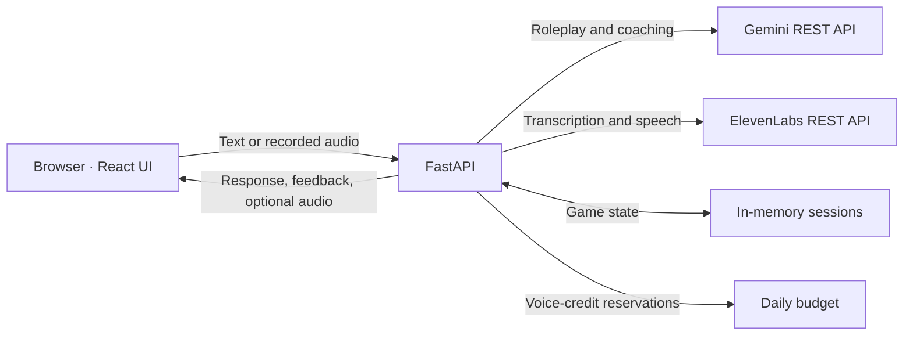

# Talk It Out

Practice hard conversations with AI characters, then review what you said and
what you could try differently. Built at Hack The Nest 2026, Eastern Michigan
University, November 14–15.

[**Live app**](https://talk-it-out-0dzk.onrender.com/) ·
[**Simulated demo — no API keys**](https://talk-it-out-0dzk.onrender.com/?mock=1)

Free hosting may take 30–60 seconds to wake after inactivity. Voice has a daily
budget; typed input remains available when it runs out. The judges' video is
submitted separately.

## The experience

Choose a toddler, angry caller, upset friend, teenager, roommate, or coworker.
Speak or type a reply, watch the character's mood change, and review coaching
notes. Optional **Try saying** hints help you get started; turn them off to
practice independently. Finish the round or choose **End & score** to see a
scorecard and transcript, then try again.

## Architecture and code map

One FastAPI service serves the React interface and API. React loads as browser
ES modules, so running the app requires no Node.js or frontend build step.



Gemini generates the dialogue, suggested mood change, hints, and scorecard.
Python validates the supported technique names and bounds, applies the game
rules, and reserves estimated voice credits before external speech calls.

| Start here | Responsibility |
|---|---|
| [API routes](backend/app/main.py) | Sessions, turns, scorecards, health, and frontend serving |
| [Game state](backend/app/sessions.py) | In-memory storage, turn limits, and outcome rules |
| [Characters](backend/app/characters.py) | Personas and the authoritative scenario catalog |
| [Gemini client](backend/app/integrations/gemini.py) | Structured replies and scoring |
| [ElevenLabs client](backend/app/integrations/elevenlabs.py) | Speech transcription and MP3 generation |
| [Voice budget](backend/app/budget.py) | Atomic reservations, refunds, and daily rollover |
| [Frontend](frontend/app.js) · [components](frontend/components/) | Character picker, conversation, meter, and scorecard |
| [API client and simulator](frontend/api.js) | Real requests and clearly labeled mock behavior |
| [Backend tests](backend/tests/) · [frontend tests](frontend/tests/) | API, game, budget, and demo regression checks |

Payloads, environment variables, and deployment behavior are documented in the
[API contract](docs/API_CONTRACT.md).

## Quick start

**Prerequisites:** Python 3.12 is verified. Internet access is needed for browser
modules and live AI services. Node 22+ is needed only for the optional frontend
regression checks.

Run commands from the repository root. Choose your platform below.

### 1. Install dependencies and prepare local configuration

**macOS / Linux**

```bash
python3 -m venv backend/.venv
backend/.venv/bin/python -m pip install -r backend/requirements.txt
test -f .env || cp .env.example .env
```

**Windows PowerShell**

```powershell
python -m venv backend/.venv
backend/.venv/Scripts/python -m pip install -r backend/requirements.txt
if (!(Test-Path .env)) { Copy-Item .env.example .env }
```

### 2. Configure live services

Before starting the server, edit `.env` and set `GEMINI_API_KEY` and
`ELEVENLABS_API_KEY`. The copy commands above preserve an existing `.env`.
Approved environment secret storage can be used instead. Never commit key values.
See the [configuration reference](docs/API_CONTRACT.md#env-vars-repo-root-env-git-ignored-names-only-here)
for optional settings and defaults. Provider accounts:
[Google AI Studio](https://aistudio.google.com/) and [ElevenLabs](https://elevenlabs.io/).

To explore only the simulated demo, leave keys unset and use `?mock=1`.

### 3. Start and open the app

**macOS / Linux**

```bash
backend/.venv/bin/python -m uvicorn app.main:app --app-dir backend --reload --port 8000
```

**Windows PowerShell**

```powershell
backend/.venv/Scripts/python -m uvicorn app.main:app --app-dir backend --reload --port 8000
```

Open <http://localhost:8000> for live conversations, or
<http://localhost:8000/?mock=1> for the simulator. Keep the terminal running;
Ctrl+C stops the server. `/api/health` reports configured-key presence and budget
availability, not successful authentication with the providers.

## Validation and demo data

Backend checks use fake integrations and need no API keys:

```bash
backend/.venv/bin/python -m pytest backend/tests
```

On Windows, use `backend/.venv/Scripts/python` instead. Optional frontend checks:

```bash
node --test frontend/tests/api.test.mjs
```

`frontend/characters.json` is generated from the live character definitions. After
changing those definitions, regenerate it with the appropriate Python interpreter:

```bash
python3 backend/scripts/export_demo_characters.py
```

On Windows, use `python` instead. Do not edit the JSON manually; the backend
suite checks that the static demo catalog matches the live catalog. Test outcomes
and live checks are recorded in [agent handoffs](docs/AGENT_HANDOFFS.md).

## Current boundaries

- Sessions and voice-budget counters live in one server process and reset on
  restart. There are no accounts, database, or saved practice history.
- Voice is recorded and sent in turns. Scoring uses the transcript, not vocal
  tone or volume. Generated scores are coaching feedback, not validated learning measures.
- Mock mode uses matching scenario data but simulated replies and scorecards;
  it does not call Gemini/ElevenLabs or provide real transcription/playback.
  `?mock=1&novoice=1` exercises the text fallback.
- Automated tests and a live typed Gemini round were verified. Real microphone
  capture/transcription still needs team verification on the recording/judging device.

## Documentation

[API contract](docs/API_CONTRACT.md) · [Team and selected tracks](docs/TEAM_DECISIONS.md) ·
[Documentation index](docs/README.md)

The index separates technical references, submission preparation, research, and
agent coordination. All contributors and agents follow [AGENTS.md](AGENTS.md).
